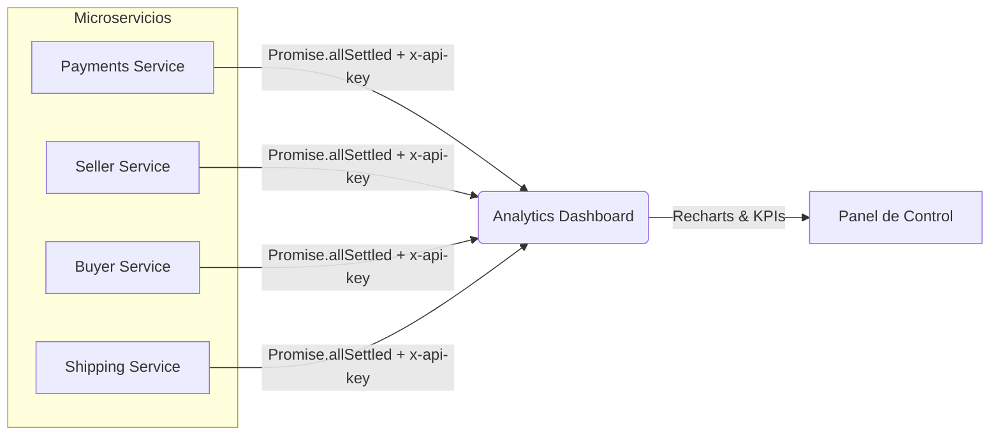

# 📊 CompuLibre — Analytics Dashboard


Panel de control analítico y consolidación de métricas para **CompuLibre** (marketplace de hardware). Agrega información global en tiempo real consultando de forma asíncrona y tolerante a fallos las APIs de 4 microservicios del ecosistema (Payments, Buyer, Seller y Shipping/Logistics).

---

## Demo en Vivo

 **[etapa-3-analytics-dashboard-compuli.vercel.app](https://etapa-3-analytics-dashboard-compuli.vercel.app/)**

> Si Clerk solicita código 2FA en el login de prueba, ingresar **`424242`**.

* **Administrador (Acceso completo):** `administrador+clerk_test@iaw.com` | `iawuser#`
* **Usuario Estándar (Acceso restringido):** `usuario+clerk_test@iaw.com` | `iawuser#` *(Para probar la pantalla de bloqueo por rol)*

---

## Arquitectura y Agregación



---

## Características del Sistema

* **Agregación Asíncrona Resiliente:** Consulta paralela a múltiples microservicios mediante `Promise.allSettled`, asegurando que si un servicio secundario experimenta latencia o caída, el dashboard degrade con gracia mostrando datos por defecto sin romperse.
* **Cache & Revalidación (ISR):** Implementación de revalidación con Next.js Data Cache (`next: { revalidate: 60 }`), reduciendo la sobrecarga de peticiones inter-servicio a un máximo de una llamada por minuto por microservicio.
* **Visualización de Datos con Recharts:** Gráficos interactivos de evolución de ingresos (`AreaChart`), distribución de ventas por categorías (`LeaderboardChart`), estado logístico de entregas (`ShippingStatusChart`) y conversión de órdenes vs pagos (`ConversionChart`).
* **Seguimiento de Metas Mensuales:** Indicadores de progreso porcentual respecto a objetivos comerciales globales de la plataforma (volumen bruto, pedidos, pagos y usuarios).
* **Control de Acceso Estricto (RBAC):** Middleware de Clerk (`proxy.ts`) que protege las rutas del dashboard, permitiendo el acceso únicamente a usuarios con rol `admin` y redirigiendo a una vista dedicada de acceso no autorizado (`/unauthorized`).
* **Seguridad Inter-Servicios:** Autenticación en las consultas salientes hacia las APIs de cada microservicio mediante cabeceras `x-api-key`.

---

## Puesta en Marcha Local

```bash
# 1. Instalar dependencias
npm install

# 2. Configurar variables de entorno
cp .env.example .env.local

# 3. Iniciar entorno de desarrollo
npm run dev
```

---

## Ecosistema CompuLibre

Este proyecto forma parte de la arquitectura distribuida del marketplace CompuLibre:
* **[CompuLibre Payments Service](https://github.com/JuanseGenca/compulibre-payments-service):** Microservicio financiero y pasarela de pagos multi-vendedor con Mercado Pago.
